  <!-- CINEMATIC STUDIO BANNER -->
  

    

  <!-- DYNAMIC TYPING CONSOLE -->
  

   

  <!-- FLOATING NAVIGATION ISLAND -->
  

    
    &nbsp;
    
    &nbsp;
    
    &nbsp;
    
  

---

### SYSTEM RUNTIME &amp; IDENTITY

  

---

### FEATURED ARCHITECTURES &amp; LABS

<table width="100%" border="0" cellpadding="0" cellspacing="8">
  <tr>
    <td width="50%" align="center">
      
    </td>
    <td width="50%" align="center">
      
    </td>
  </tr>
  <tr>
    <td width="50%" align="center">
      
    </td>
    <td width="50%" align="center">
      
    </td>
  </tr>
</table>

---

### CREATIVE LAB &amp; TECHNICAL MEDIA PRODUCTION

  

---

### TECHNICAL ARSENAL &amp; ECOSYSTEM

  
<strong>CORE LANGUAGES, RUNTIMES &amp; INFRASTRUCTURE</strong>

  

    

  
<strong>APPLIED RESEARCH, VISION &amp; MEDIA WORKFLOW</strong>

  

    
    &nbsp;
    
    &nbsp;
    
    &nbsp;
    
  

---

### TELEMETRY &amp; LIVE ACTIVITY

  <table border="0" cellpadding="0" cellspacing="10" width="100%">
    <tr>
      <td width="50%" align="center">
        
      </td>
      <td width="50%" align="center">
        
      </td>
    </tr>
    <tr>
      <td colspan="2" align="center">
        
      </td>
    </tr>
  </table>

---

### HARDWARE RIG &amp; SYSTEM ENVIRONMENT

  
<strong>Inspect Workstation Architecture &amp; Production Gear</strong>

   
  <table>
    <tr>
      <td><strong>Compute Node</strong></td>
      <td>Intel Architecture • NVIDIA Hardware Acceleration • CUDA 12.x</td>
    </tr>
    <tr>
      <td><strong>Video Post-Production</strong></td>
      <td>Blackmagic DaVinci Resolve Studio (Color Grading, Fairlight Audio, Systems Motion)</td>
    </tr>
    <tr>
      <td><strong>Runtimes &amp; Compilers</strong></td>
      <td>Python 3.11+ • Dart 3.x / Flutter Framework • C++20 • GCC / LLVM</td>
    </tr>
    <tr>
      <td><strong>Research Focus</strong></td>
      <td>Synthetic Media Forensics • Spatial Boundary Anomaly Detection • DevTool Automation</td>
    </tr>
  </table>

---

### TRANSMISSION &amp; CONTACT

  
Available for high-impact AI research collaborations, devtool architecture, and technical engineering content.

  

    
    &nbsp;
    
    &nbsp;
    
    &nbsp;
    
  

   

  

    <code>SYSTEM SIGNATURE // ABDULSAMAD S. • CRAFTED WITH BESPOKE SVG ARCHITECTURE</code>
  

