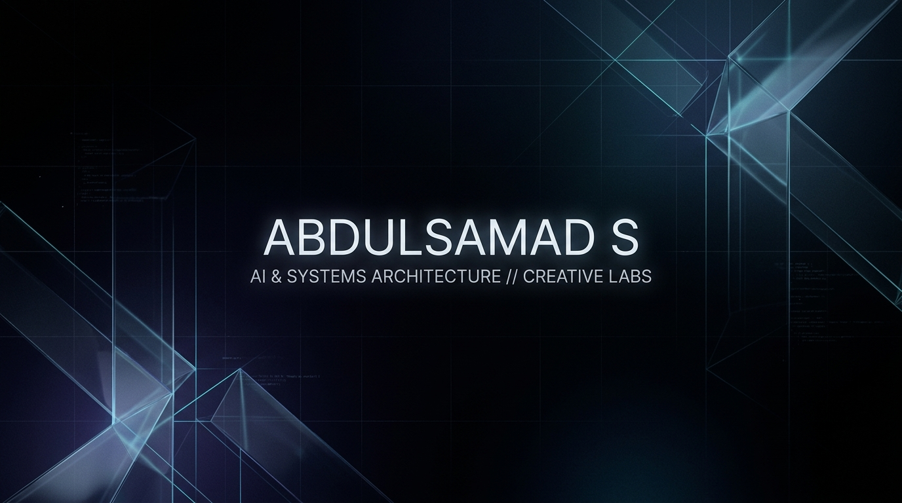

<!-- ================================================================= -->
<!-- ABDULSAMAD S. (@samad162) | GITHUB PROFILE README                -->
<!-- DESIGN ARCHETYPE: DARK TECH / MINIMALIST UTILITARIAN CREATOR HUB -->
<!-- ================================================================= -->

<div align="center">

  <!-- CINEMATIC HERO BANNER -->
  <picture>
    <source media="(prefers-color-scheme: dark)" srcset="assets/banner.jpg">
    <source media="(prefers-color-scheme: light)" srcset="assets/banner.jpg">
    
  </picture>

  <br/><br/>

  <!-- DYNAMIC TYPING TERMINAL -->
  <a href="https://github.com/samad162">
    
  </a>

  <br/>

  <!-- MINIMALIST STATUS PILLS -->
  <p align="center">
    
    
    
    
  </p>

</div>

---

### // 01. EXECUTIVE BRIEF

> **Bridging theoretical deep learning and developer experience.**
> Focused on forensic computer vision systems, high-efficiency CLI pipelines, and expressive component architectures. Alongside shipping production code, I engineer technical media workflows and system architecture breakdowns for the developer community.

* **Specialization:** Deep Learning Architectures • Vision Artifact Forensics • Edge Quantization • DevTool Engineering
* **Academic Base:** AI & Data Science Scholar @ Selvam College of Technology
* **Creative Discipline:** DaVinci Resolve Studio Post-Production • Technical Storytelling • Visual Systems

---

### // 02. FLAGSHIP ARCHITECTURES

<table>
  <tr>
    <td width="50%" valign="top">
      <div align="left">
        <h3><a href="https://github.com/samad162/AEGIS_Deepfake_Engine_PRO">AEGIS Deepfake Engine PRO</a></h3>
        <p><em>Deepfake Detection &amp; Digital Media Forensics</em></p>
        <p>High-precision neural vision engine engineered to expose synthetic facial manipulation, spatial boundary artifacts, and frequency-domain anomalies in video streams.</p>
        <p>
          
          
          
        </p>
      </div>
    </td>
    <td width="50%" valign="top">
      <div align="left">
        <h3><a href="https://github.com/samad162/feather">Feather UI Design System</a></h3>
        <p><em>Open-Source Flutter Component Library &amp; CLI</em></p>
        <p>Developer-first Flutter framework delivering prebuilt high-taste UI templates, widgets, instant playground previews, and a dedicated CLI for rapid project scaffolding.</p>
        <p>
          
          
          
        </p>
      </div>
    </td>
  </tr>
  <tr>
    <td width="50%" valign="top">
      <div align="left">
        <h3><a href="https://github.com/samad162/dartlane">Dartlane</a></h3>
        <p><em>Task Orchestration &amp; Lane Runner for Dart</em></p>
        <p>A fast, flexible CLI tool inspired by Fastlane to define, automate, and orchestrate complex build lanes and deployment workflows across Dart and Flutter apps.</p>
        <p>
          
          
          
        </p>
      </div>
    </td>
    <td width="50%" valign="top">
      <div align="left">
        <h3><a href="https://github.com/samad162/ai_code_risk_predictor">AI Code Risk Predictor</a></h3>
        <p><em>Intelligent Codebase Vulnerability Forecaster</em></p>
        <p>Machine learning-powered static intelligence engine that parses source code patterns to predict security vulnerabilities and structural risk factors prior to deployment.</p>
        <p>
          
          
          
        </p>
      </div>
    </td>
  </tr>
</table>

---

### // 03. TECHNICAL ARSENAL

<div align="left">

#### • Core Intelligence &amp; Mathematical Modeling
<p>
  
  
  
  
  
  
</p>

#### • Languages &amp; System Architectures
<p>
  
  
  
  
  
  
</p>

#### • Media Creation &amp; Production Tooling
<p>
  
  
  
  
  
</p>

</div>

---

### // 04. CREATOR &amp; LAB TELEMETRY

<div align="center">
  <table border="0" cellpadding="0" cellspacing="10">
    <tr>
      <td width="50%" align="center">
        <a href="https://github.com/samad162">
          
        </a>
      </td>
      <td width="50%" align="center">
        <a href="https://github.com/samad162">
          
        </a>
      </td>
    </tr>
    <tr>
      <td colspan="2" align="center">
        <a href="https://github.com/samad162">
          
        </a>
      </td>
    </tr>
  </table>
</div>

---

### // 05. CONTENT LAB // PRODUCTION PIPELINE

```
┌────────────────────────────────────────────────────────────────────────┐
│  STAGE 01: ARCHITECTURE RESEARCH                                       │
│  Deep dive into state-of-the-art vision models & devtool bottlenecks   │
└───────────────────────────────────┬────────────────────────────────────┘
                                    │
┌───────────────────────────────────▼────────────────────────────────────┐
│  STAGE 02: CODEBASE SYNTHESIS                                          │
│  Architect modular open-source repositories with clean CLI & test coverage│
└───────────────────────────────────┬────────────────────────────────────┘
                                    │
┌───────────────────────────────────▼────────────────────────────────────┐
│  STAGE 03: VISUAL BROADCAST & SYSTEM BREAKDOWNS                        │
│  Post-production in DaVinci Resolve Studio • Interactive walkthroughs  │
└────────────────────────────────────────────────────────────────────────┘
```

---

### // 06. TRANSMISSION &amp; CONNECT TERMINAL

<div align="center">

  <p>Available for high-impact AI research collaborations, developer tooling, and technical engineering content.</p>

  <p>
    <a href="https://twitter.com/DEVIL12457">
      
    </a>
    &nbsp;
    <a href="https://github.com/samad162">
      
    </a>
    &nbsp;
    <a href="https://huggingface.co">
      
    </a>
    &nbsp;
    <a href="mailto:samad12457h@gmail.com">
      
    </a>
  </p>

  <br/>

  <p>
    <sub><code>SYSTEM SIGNATURE // ABDULSAMAD S. • BUILT WITH VANGUARD DESIGN ARCHITECTURE</code></sub>
  </p>

</div>
