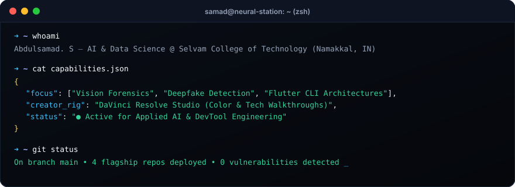
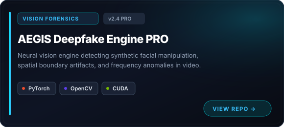
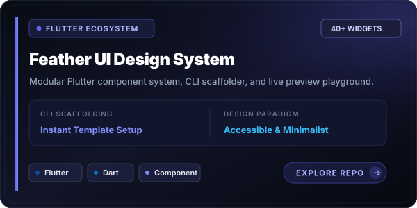
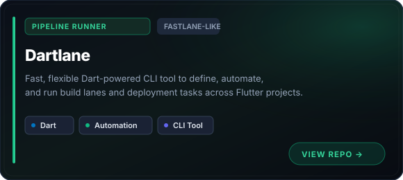
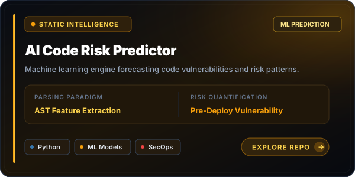

<!-- ================================================================= -->
<!-- ABDULSAMAD S. (@samad162) | MODERN DYNAMIC WEB PROFILE            -->
<!-- DESIGN SYSTEM: ADAPTIVE DUAL-THEME // BESPOKE SVG BENTO ARCHITECTURE -->
<!-- ================================================================= -->

  <!-- ADAPTIVE DUAL-THEME HERO (AUTOMATIC DARK / LIGHT MODE SWITCHING) -->
  <picture>
    <source media="(prefers-color-scheme: dark)" srcset="assets/hero-dark.svg">
    <source media="(prefers-color-scheme: light)" srcset="assets/hero-light.svg">
    
  </picture>

    

  <!-- DYNAMIC TYPING CONSOLE -->
  

   

  <!-- VERIFIED IDENTITY TELEMETRY -->
  

    
    &nbsp;
    
    &nbsp;
    
    &nbsp;
    
  

---

### // 01. DEVELOPER TERMINAL SESSION

  

---

### // 02. FLAGSHIP ARCHITECTURES (BENTO GRID)

<table width="100%" border="0" cellpadding="0" cellspacing="8">
  <tr>
    <td width="50%" align="center">
      
    </td>
    <td width="50%" align="center">
      
    </td>
  </tr>
  <tr>
    <td width="50%" align="center">
      
    </td>
    <td width="50%" align="center">
      
    </td>
  </tr>
</table>

---

### // 03. TECHNICAL ARSENAL &amp; ECOSYSTEM

  
<strong>CORE LANGUAGES, RUNTIMES &amp; INFRASTRUCTURE</strong>

  

    

  
<strong>APPLIED RESEARCH &amp; PRODUCTION MEDIA STACK</strong>

  

    
    &nbsp;
    
    &nbsp;
    
    &nbsp;
    
    &nbsp;
    
  

---

### // 04. LIVE TELEMETRY &amp; ACTIVITY METRICS

  <table border="0" cellpadding="0" cellspacing="10" width="100%">
    <tr>
      <td width="50%" align="center">
        
      </td>
      <td width="50%" align="center">
        
      </td>
    </tr>
    <tr>
      <td colspan="2" align="center">
        
      </td>
    </tr>
  </table>

---

### // 05. CREATOR RIG &amp; SYSTEM SPECIFICATIONS

  
<strong>► CLICK TO INSPECT WORKSTATION &amp; PRODUCTION RIG</strong>

   
  <table>
    <tr>
      <td><strong>Compute Node</strong></td>
      <td>Intel / NVIDIA Acceleration • CUDA Enabled</td>
    </tr>
    <tr>
      <td><strong>Post-Production Suite</strong></td>
      <td>Blackmagic DaVinci Resolve Studio (Color Science &amp; Video Walkthroughs)</td>
    </tr>
    <tr>
      <td><strong>Primary Runtimes</strong></td>
      <td>Python 3.11+ • Dart 3.x / Flutter SDK • C++20 • Node.js</td>
    </tr>
    <tr>
      <td><strong>Specializations</strong></td>
      <td>Deepfake Boundary Analysis • Quantized Edge Vision • CLI Architecture</td>
    </tr>
  </table>

---

### // 06. TRANSMISSION &amp; CONNECT TERMINAL

  
Open for applied AI research, developer experience tooling, and technical engineering collaborations.

  

    
    &nbsp;
    
    &nbsp;
    
    &nbsp;
    
  

   

  

    <code>SYSTEM SIGNATURE // ABDULSAMAD S. • BUILT WITH MODERN DUAL-THEME SVG ARCHITECTURE</code>
  

